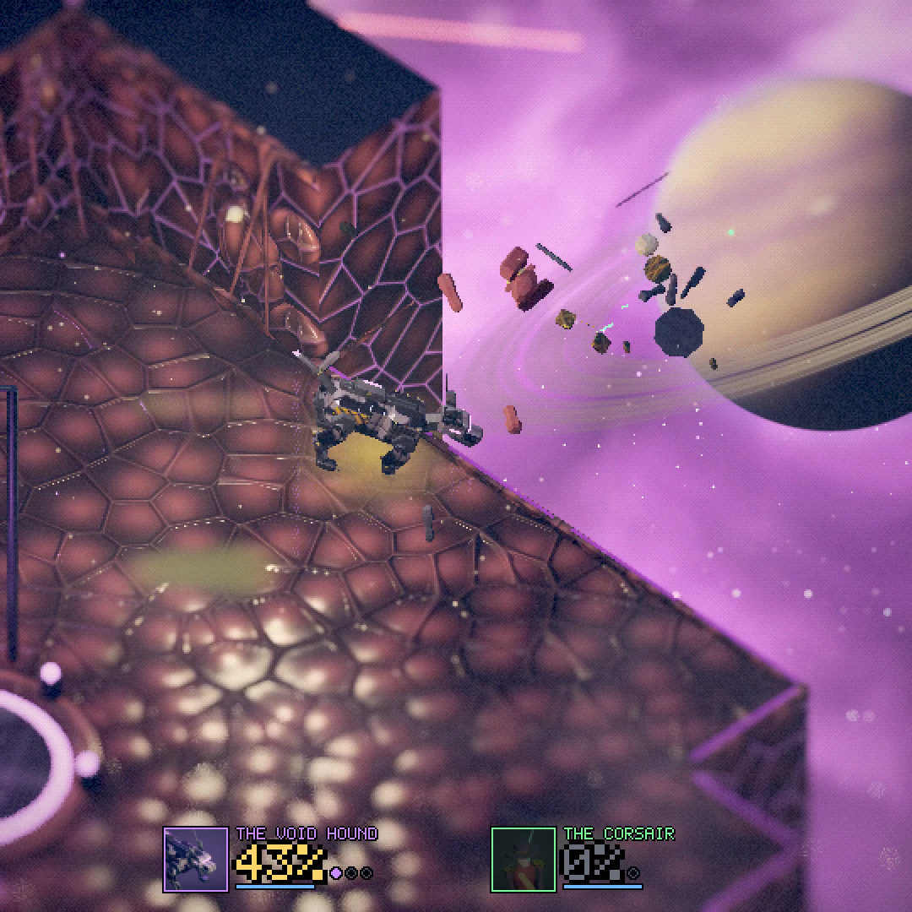

# Voidlight Duel

A ring-out arena fighter in one self-contained HTML file (about 148 KB, no engine, no assets): every texture, model, sound and arena is generated in code.

**Play:** https://kevintngo.github.io/arena-fighter/

Gameplay clip: [trailer/voidlight-duel-x.mp4](trailer/voidlight-duel-x.mp4)

## How it plays

- Pick one of ten duellists, then ride the lift down to one opponent after another on procedurally built decks.
- Damage % makes every hit throw you further. Get knocked off the deck and you lose a stock. There is no way back from a fall, so hold your ground.
- Keyboard: `WASD` / arrows move, `J` attack, `K` heavy (hold to charge), `L` special, `Space` guard (with a direction: dodge roll; then attack: grab). Gamepad and touch controls are also supported.

## Build

`sh build.sh` packs `src/` into `index.html`. `sh build.sh dev` writes a readable `dev.html` with test hooks.
